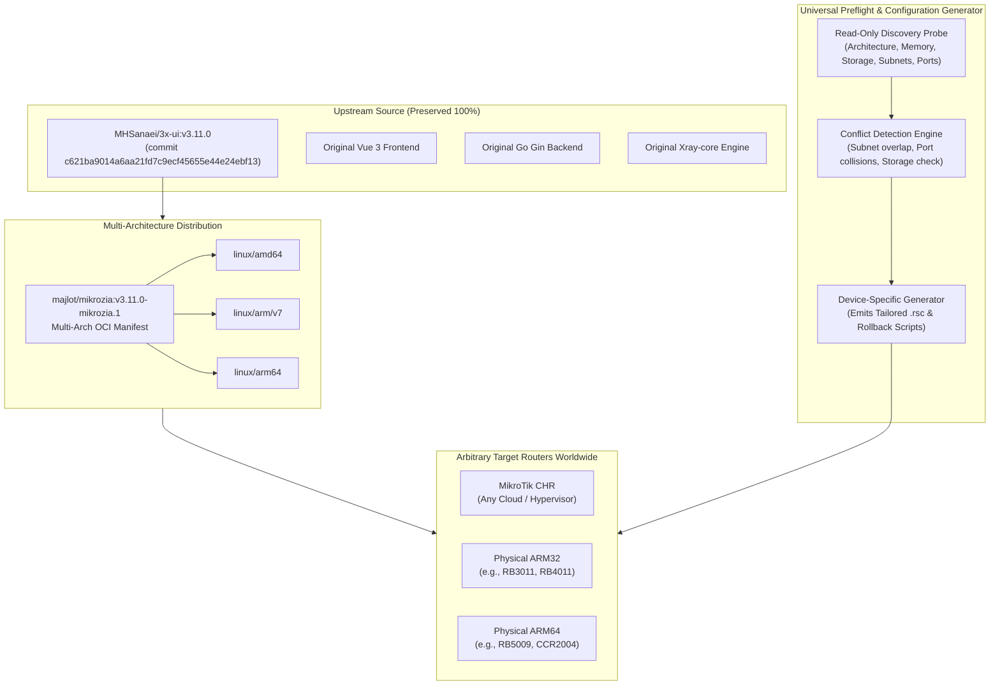
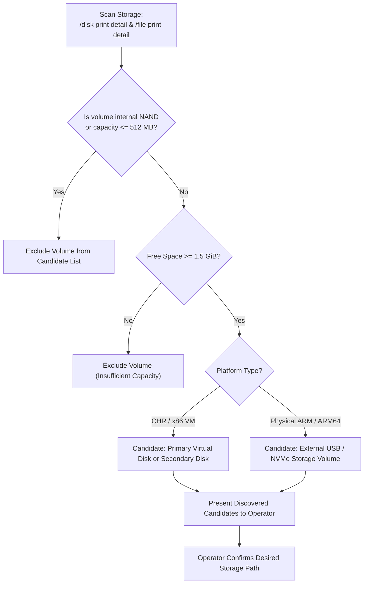
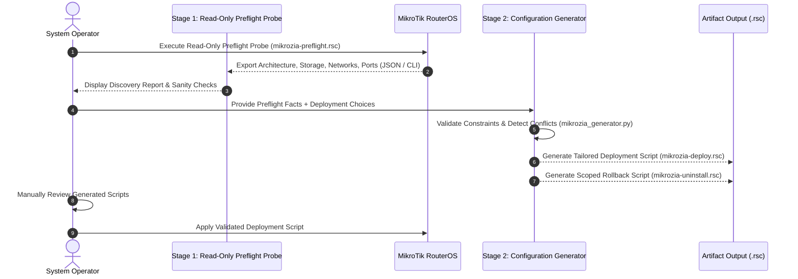
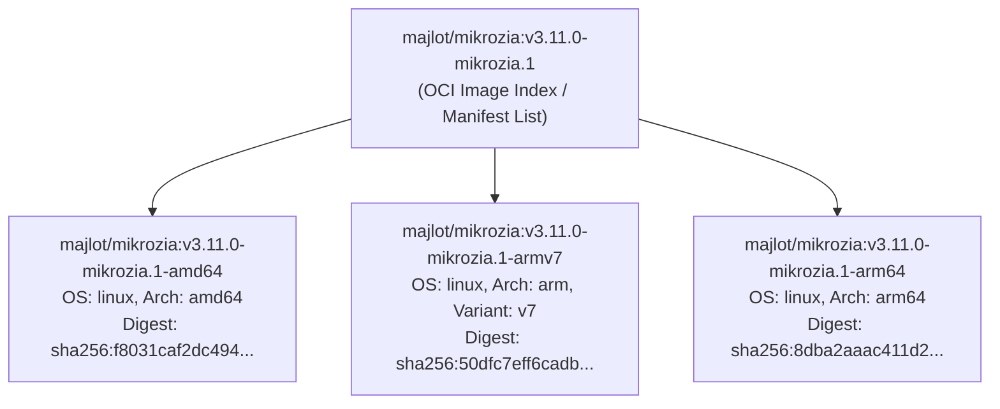
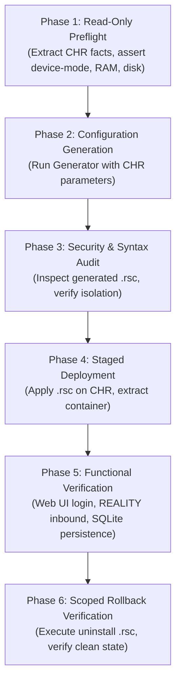

# MIKROZIA — GLOBAL ROUTEROS DEPLOYMENT ARCHITECTURE

**Document Version:** 1.0.0
**Date:** November 1, 2026
**Status:** HISTORICAL — SUPERSEDED BY THE CONTAINER-ONLY ARCHITECTURE
**Current Policy:** Mikrozia does not generate or manage RouterOS Firewall/NAT. Use `MIKROZIA_CHR_INSTALL_FA.md`.
**Application Baseline:** Original, Unmodified 3x-ui `v3.11.0` (Upstream commit `c621ba9014a6aa21fd7c9ecf45655e44e24ebf13`)
**Target Repository:** `majlot/mikrozia`
**Target Platforms:** MikroTik RouterOS v7.25+ (Cloud Hosted Router x86_64, Physical ARM 32-bit v7, Physical ARM64)

---

## 1. Executive Summary & Product Vision

### 1.1 Universal Distributability vs. Reference Environments

Mikrozia is engineered for **worldwide distribution across diverse MikroTik RouterOS deployments**, not for a single specific router, cloud host, or lab setup.



- **Reference Environments as Verification Fixtures Only:** Any reference hardware mentioned in testing (such as the owner's Hetzner CHR or physical RB3011UiAS) serves strictly as an external test fixture. No particular IP address, interface name (`ether1`, `wireguard1`), disk name (`disk1`, `usb1`), subnet (`172.16.10.0/24`), or port forwarding configuration from these fixtures is hardcoded into the Mikrozia architecture.
- **Genuine Upstream Integrity:** The application source code, Vue 3 / Vite frontend, Gin backend, Xray core binaries, menus, database schema, and branding remain completely original and unmodified.
- **Non-Destructive Guarantee:** Mikrozia deployment tools never format storage drives, reboot routers automatically, overwrite unrelated firewall rules, or touch unmanaged network interfaces.
- **Strict Zero-Trust Management Security:** The 3x-ui administrative panel (`:2053`) is strictly isolated from the public Internet. Under no circumstances does the configuration generator expose the management panel to public WAN.

---

## 2. Platform Compatibility & Hardware Requirements

### 2.1 Supported Hardware Architectures

| Target Category               | Architecture Identifier | Common MikroTik Hardware Models                              | Supported Storage Types                   |
| :---------------------------- | :---------------------- | :----------------------------------------------------------- | :---------------------------------------- |
| **Cloud Hosted Router (CHR)** | `linux/amd64`           | AWS, Hetzner, Proxmox, ESXi, KVM, VirtualBox, Bare-metal x86 | Virtual Disk (VirtIO / SCSI / SATA)       |
| **Physical ARM 32-bit (v7)**  | `linux/arm/v7`          | RB3011UiAS, RB4011iGS+RM (ARM 32-bit mode), hAP ac³          | External USB 3.0 SSD/Flash (`ext4`)       |
| **Physical ARM 64-bit**       | `linux/arm64`           | RB5009UG+S+IN, CCR2004, CCR2116, hAP ax², hAP ax³, L009UiGS  | External USB 3.0 / M.2 PCIe NVMe (`ext4`) |

### 2.2 System Memory Baseline

- **Mandatory Router RAM:** Minimum router system RAM is **1024 MiB (1 GiB)**.
- **Memory Allocation Breakdown:**
  - RouterOS Kernel & Core Routing Services: ~250–350 MiB
  - Image Unpacking & Buffer Allocation: ~150–200 MiB (during initial container extraction)
  - 3x-ui Runtime (Gin Web Framework + SQLite + Xray Core): ~98.2 MiB under 12-stream load (idle baseline: ~55 MiB)
  - Linux Page Cache, Network Buffers & Dynamic Buffers: ~300+ MiB
- **Low-Memory Disqualification:** Routers with 512 MiB total RAM or less (e.g., hEX RB750Gr3, hAP ac²) are **strictly disqualified** to prevent kernel out-of-memory panics during extraction or high concurrent proxy load.
- **Resource Sizing Limits (RouterOS cgroups):**
  - `memory-high=256M`: RouterOS throttles and initiates memory reclamation before host pressure occurs.
  - `memory-max=512M`: Hard limit to guarantee that a runaway container process cannot starve critical routing daemons.

---

## 3. Dynamic Storage Discovery & Safety Invariants

### 3.1 The Storage Abstraction Problem

Different MikroTik models, cloud hypervisors, and storage controllers assign arbitrary disk and directory names:

- CHR mounts primary virtual storage at the filesystem root, referencing subdirectories directly (e.g. `containers/`, `disk1/containers/`).
- Physical RouterBOARDs assign mount names based on port number and partition tables (e.g., `usb1`, `usb2`, `disk1`, `part1`, `nvme1-part1`, `sata1`).
- **Hardcoding paths like `disk1` or `usb1` causes immediate failures on third-party routers.**

### 3.2 Internal NAND Flash Strict Exclusion Policy

- **Flash Wear & Capacity Collapse:** Devices like the RB3011UiAS feature only 128 MiB of onboard NAND flash, with ~89.9 MiB free after RouterOS system files. The uncompressed rootfs of 3x-ui is ~450 MiB, and the compressed archive is ~107 MiB.
- **Strict Invariant:** Any storage volume identified as internal NAND (`type="nand"` or total capacity $\le 512\text{ MiB}$) is **mathematically forbidden** from being used for container extraction (`tmpdir`), rootfs layers (`root-dir`), or persistent databases.
- **Physical Hardware Rule:** All physical ARM32 and ARM64 routers **must** have an external storage medium attached (USB 3.0 SSD, high-end flash drive, or NVMe drive) with at least **1.5 GiB of free space**.

### 3.3 Dynamic Storage Discovery Logic



### 3.4 Zero-Formatting Safety Guarantee

- Mikrozia deployment tools and configuration scripts **never execute formatting commands** (such as `/disk format-drive`).
- All external media must be pre-formatted (standard `ext4` filesystem recommended) and mounted by the operator prior to running the deployment generator.

---

## 4. Network Isolation & Firewall Architecture

### 4.1 Parameterized Network Topology

Mikrozia creates a self-contained, isolated network sandbox that does not interfere with the router's existing LAN bridge, VLAN trunks, DHCP servers, or routing protocols.

```
+-----------------------------------------------------------------------------------+
|                            MikroTik RouterOS Host                                 |
|                                                                                   |
|   +------------------------------------+   +----------------------------------+   |
|   |         Public WAN Interface       |   |      LAN / Management VPN        |   |
|   |         (e.g., ether1, pppoe)      |   |   (e.g., bridge-lan, wireguard1) |   |
|   +------------------------------------+   +----------------------------------+   |
|                    |                                        |                     |
|     DST-NAT Inbound Proxy Traffic            DST-NAT or Direct Routing            |
|       (e.g. TCP/UDP 10443, 443)                   (TCP Port 2053)                 |
|       [in-interface-list=WAN]                 [RESTRICTED: LAN/VPN ONLY]          |
|                    |                                        |                     |
|                    +--------------------+-------------------+                     |
|                                         |                                         |
|                                         v                                         |
|                    +----------------------------------------+                     |
|                    |   Isolated Bridge: dockers-br          |                     |
|                    |   Gateway IP: <CONTAINER_GW> (e.g. .1) |                     |
|                    +----------------------------------------+                     |
|                                         |                                         |
|                                         | VETH Pair (<VETH_NAME>)                 |
|                                         v                                         |
|                    +----------------------------------------+                     |
|                    |      Container IP: <CONTAINER_IP>      |                     |
|                    |      (Default: 172.16.10.2/24)         |                     |
|                    |                                        |                     |
|                    |   3x-ui Unprivileged Container         |                     |
|                    |   - Admin Panel (:2053)                |                     |
|                    |   - Sub-server (:2096)                 |                     |
|                    |   - Xray Inbounds (:10443, etc.)       |                     |
|                    +----------------------------------------+                     |
|                                         |                                         |
|     Outbound Proxy Traffic              |                                         |
|     SRCNAT (Masquerade)                 v                                         |
|     chain=srcnat src-address=<SUBNET> -> [Internet / Upstream]                    |
+-----------------------------------------------------------------------------------+
```

### 4.2 Dynamic Conflict Detection Engine

Before any configuration is generated, the preflight engine inspects the router's active network state:

1. **Subnet Conflict Check:** Compares the proposed container subnet (default: `172.16.10.0/24`) against:
   - `/ip/address print detail`
   - `/ip/route print detail`
   - `/ip/pool print detail`
   - `/interface/wireguard print detail`
   - If `172.16.10.0/24` overlaps with an existing network, the generator automatically calculates the next available non-overlapping RFC 1918 block (e.g., `172.16.11.0/24`, `10.244.0.0/24`, `192.168.222.0/24`).
2. **Interface Name Collision Check:** Verifies that the proposed bridge name (`dockers-br`) and VETH name (`veth-3xui`) do not collide with existing interfaces.
3. **Port Collision Check:** Checks `/ip/firewall/nat print detail where chain=dstnat` and active `/ip/service` to verify that the proposed proxy inbound ports (e.g., `10443`) and admin port (`2053`) are not already claimed by other services.

### 4.3 Management Access Security Invariant

- **Strict Prohibition:** DST-NAT forwarding for admin port `2053` with `in-interface-list=WAN` is **strictly prohibited**.
- **Allowed Ingress Options for Port 2053:**
  1. _LAN Interface List:_ `in-interface-list=LAN` (for home/office routers with trusted internal networks).
  2. _Dedicated Management VPN:_ `in-interface=<vpn_interface>` (e.g., WireGuard, IPsec, OpenVPN tunnel).
  3. _Localhost / Direct Routing:_ No DST-NAT rule created; access restricted to internal routing over trusted subnets.

---

## 5. Universal Preflight & Configuration Generator Specification

### 5.1 Architecture Overview

The generator is structured as a two-stage decoupled engine:



### 5.2 Stage 1: Read-Only Preflight Probe (`scripts/routeros/mikrozia-preflight.rsc`)

The probe gathers system facts without modifying any router settings.

#### Execution Method:

The preflight script can be transferred to the router and imported, or pasted directly into a RouterOS CLI terminal session:

```routeros
/import file-name=mikrozia-preflight.rsc
# Or paste contents directly into RouterOS terminal
```

#### Probe Data Schema (JSON):

```json
{
  "routeros": {
    "version": "7.25",
    "architecture": "arm",
    "board_name": "RB3011UiAS",
    "cpu_model": "IPQ-8064",
    "total_memory_bytes": 1073741824,
    "free_memory_bytes": 892344320
  },
  "device_mode": {
    "container_enabled": true
  },
  "container_package": {
    "installed": true,
    "version": "7.25"
  },
  "storage_candidates": [
    {
      "name": "usb1",
      "path": "usb1",
      "type": "usb",
      "total_bytes": 31457280000,
      "free_bytes": 28934144000,
      "valid_candidate": true
    },
    {
      "name": "nand",
      "path": "",
      "type": "nand",
      "total_bytes": 134217728,
      "free_bytes": 94371840,
      "valid_candidate": false,
      "disqualification_reason": "Internal NAND flash forbidden"
    }
  ],
  "network": {
    "existing_subnets": ["192.168.88.0/24", "10.10.0.0/24"],
    "wan_interface_lists": ["WAN"],
    "lan_interface_lists": ["LAN"],
    "management_interfaces": ["bridge", "wireguard1"]
  },
  "port_conflicts": {
    "claimed_tcp_ports": [22, 53, 80, 443, 8291]
  }
}
```

### 5.3 Stage 2: Configuration Generator (`scripts/generator/mikrozia_generator.py`)

The universal configuration generator is implemented as a standalone, zero-dependency Python utility located at [scripts/generator/mikrozia_generator.py](file:///Users/majidlotfi/Documents/Project/Mikrozia/scripts/generator/mikrozia_generator.py).

#### Generator Invocation Example:

```bash
# Example 1: Physical ARM32 RouterBOARD (e.g. RB3011 with external USB drive)
python3 scripts/generator/mikrozia_generator.py \
  --arch arm \
  --platform-type physical \
  --ram-mb 1024 \
  --storage-path usb1 \
  --container-subnet 172.16.10.0/24 \
  --admin-access-type lan_list \
  --admin-interface-name LAN \
  --proxy-ports 10443:tcp 443:tcp \
  --prefix rb3011

# Example 2: Cloud Hosted Router (CHR x86_64 with management VPN)
python3 scripts/generator/mikrozia_generator.py \
  --arch amd64 \
  --platform-type chr \
  --ram-mb 2048 \
  --storage-path containers \
  --container-subnet 172.16.10.0/24 \
  --admin-access-type vpn_interface \
  --admin-interface-name wireguard1 \
  --proxy-ports 10443:tcp \
  --prefix chr
```

#### Generator Input Parameters:

1. `preflight_data`: Validated JSON report from Stage 1.
2. `storage_volume`: Discovered storage volume (e.g., `usb1` on physical router, `containers` on CHR).
3. `container_subnet`: Proposed container subnet (default: `172.16.10.0/24`).
4. `proxy_inbound_ports`: Array of port mappings to expose on WAN (e.g. `[{"protocol": "tcp", "port": 10443}]`).
5. `admin_access_mode`: One of:
   - `lan_list`: Restricted to `in-interface-list=LAN`
   - `vpn_interface`: Restricted to a specific interface (e.g., `wireguard1`)
   - `none`: No NAT rule; direct route only.
6. `image_source_mode`: `local_file` (offline `.tar` upload) or `docker_registry` (pull from Docker Hub).

#### Generator Template Engine Rules:

- All generated RouterOS objects are tagged with a standard comment: `[Mikrozia] <Description>`.
- CLI syntax matches RouterOS v7.25+ specifications:
  - Mounts created with `/container/mounts/add list=... src=... dst=...` (RouterOS v7.21+ mount-list syntax)
  - Environment lists created with `/container/envs/add list=... key=... value=...`
  - Global limits configured via `/container/config/set tmpdir=... memory-high=256M memory-max=512M`
  - Container instantiated via `/container/add file=... mountlists=... envlist=...`
  - No Fail2ban or firewall-capability variables in the envlist; `XUI_ENABLE_FAIL2BAN`
    was retired in P0-F2B-01 and no longer exists.

---

## 6. Safe Multi-Platform Docker Hub Release Plan

### 6.1 Distribution Repository & Tagging Architecture

- **Target Registry:** Docker Hub
- **Repository Path:** `majlot/mikrozia`
- **Immutable Version Scheme:** `v3.11.0-mikrozia.1`
  - Incorporates upstream release version (`v3.11.0`)
  - Incorporates packaging iteration suffix (`-mikrozia.1`)
  - **Strict Release Rule:** The mutable tag `latest` is **not used** during initial rollout to ensure reproducible, deterministic deployments.

### 6.2 Multi-Architecture Manifest Structure

The multi-architecture manifest links the three validated single-architecture images:



### 6.3 Licensing, Copyright & Upstream Attribution

Mikrozia distributes the unmodified 3x-ui application under the **GNU General Public License v3.0 (GPL-3.0)**.
To maintain full legal and ethical compliance:

1. **Upstream Copyright Notice:** Explicit credit to upstream author `MHSanaei` and 3x-ui contributors.
2. **Source Code Availability:** Clear link to upstream commit `c621ba9014a6aa21fd7c9ecf45655e44e24ebf13` and the public Mikrozia packaging repository.
3. **Packaging Transparency:** Prominently state in Docker Hub descriptions:
   > _"Mikrozia is a multi-architecture container distribution of the genuine, unmodified 3x-ui v3.11.0 application, packaged specifically for MikroTik RouterOS Container deployments. Mikrozia is not affiliated with, endorsed by, or sponsored by MikroTik SIA."_
4. **No Derivative Code Claim:** Never claim original authorship of the 3x-ui application codebase or UI.

### 6.4 Publication Pipeline & Security Safeguards

1. **Pre-Publish Verification:** Verify each architecture package against local cryptographic checksums:
   - `3xui_amd64.tar` &rarr; `f8031caf2dc494f0821ccd3fffb04888379687cc219bed172b1053ba35026e76`
   - `3xui_armv7.tar` &rarr; `50dfc7eff6cadbcf4d435689976d142bfc570caa0847f04895741ef71f17950f`
   - `3xui_arm64.tar` &rarr; `8dba2aaac411d253b4b658134905293fa59b66b3e8b3ff7a5f14fc92ebb08c6a`
2. **Credential Safety:** Docker Hub authentication must use an encrypted credential helper or temporary Personal Access Token (PAT). Passwords and tokens must never appear in command lines, log outputs, or committed files.
3. **Multi-Arch Manifest Assembly:** Use `docker buildx imagetools create` to assemble the multi-platform manifest without re-compiling or modifying layer blobs.
4. **Post-Publish Inspection:** Execute `docker buildx imagetools inspect majlot/mikrozia:v3.11.0-mikrozia.1` to confirm manifest descriptors and per-architecture digests.

---

## 7. CHR Acceptance-Test Plan (Owner's Fixture)

### 7.1 Scope & Purpose

The owner's Hetzner CHR x86_64 instance is utilized strictly as a **hardware-in-the-loop verification fixture** to validate the universal generator before releasing to external operators.

### 7.2 Staged Test Phases



#### Phase 1: Read-Only Preflight Verification

- Verify RouterOS version ($\ge 7.25$) and architecture (`x86_64`).
- Verify `/system/device-mode print` reports `container: yes`.
- Verify `/disk print` shows primary virtual disk with $\ge 1.5\text{ GiB}$ free space.
- Verify existing interfaces and firewall rules are mapped.

#### Phase 2: Configuration Generation

- Supply CHR preflight facts to the Universal Generator.
- Confirm generator selects virtual disk path (e.g. `containers/`).
- Confirm admin access is restricted to management VPN or LAN list.
- Confirm proxy inbound is mapped to designated port (e.g. 10443).

#### Phase 3: Operator Audit & Approval

- Manually inspect `chr-mikrozia-deploy.rsc`.
- Verify that every command includes `comment="[Mikrozia] ..."`.
- Verify that no rules modify the CHR host default gateway or primary interfaces.

#### Phase 4: Staged Deployment

- Upload `3xui_amd64.tar` to CHR storage.
- Execute `chr-mikrozia-deploy.rsc` via RouterOS CLI.
- Monitor extraction via `/container/print follow-only`.

#### Phase 5: Functional & Security Acceptance

- **Management UI Test:** Connect to `http://<CHR_VPN_OR_LAN_IP>:2053/` and verify the genuine 3x-ui login page renders.
- **WAN Isolation Test:** Attempt to access `http://<CHR_PUBLIC_IP>:2053/` from an external network and verify that connection is **refused / dropped**.
- **Inbound Provisioning Test:** Create a VLESS REALITY inbound on port `10443` through the 3x-ui web panel.
- **Traffic Forwarding Test:** Connect a test client to `<CHR_PUBLIC_IP>:10443` and verify outbound traffic flows successfully.
- **Persistence Test:** Stop container, reboot CHR, verify container restarts automatically and all inbounds/settings persist.

#### Phase 6: Scoped Rollback Verification

- Execute `chr-mikrozia-uninstall.rsc`.
- Confirm container is stopped and removed.
- Confirm mounts, envlists, VETH, bridge, and NAT rules are cleanly removed.
- Confirm that host routing, base firewall, and management access remain completely intact.

---

## 8. Lifecycle Management: Upgrades & Scoped Rollback

### 8.1 Database & Certificate Preservation Model

To allow seamless container upgrades without losing user accounts, client UUIDs, traffic statistics, or SSL certificates, Mikrozia isolates state outside the container rootfs:

```
<STORAGE_PATH>/
  └── 3xui/
      ├── root/            <- Ephemeral RootFS (Overwritten during upgrades)
      ├── data/            <- PERSISTENT (/etc/x-ui/x-ui.db & settings)
      └── cert/            <- PERSISTENT (/root/cert/ TLS certificates)
```

During container recreation, the volume mounts bind the persistent directories directly into the new container instance.

### 8.2 In-Place Upgrade Workflow

1. Download or pull the new version archive (e.g., `v3.11.0-mikrozia.2`).
2. Stop the existing container: `/container/stop [find where comment~"\\[Mikrozia\\]"]`
3. Remove the container object: `/container/remove [find where comment~"\\[Mikrozia\\]"]`
4. Re-instantiate the container with the updated image, referencing the existing `mounts` and `envlist`.
5. Start the new container: `/container/start [find where comment~"\\[Mikrozia\\]"]`
6. Verify database integrity and active inbounds.

### 8.3 Scoped Rollback Script Architecture

Every generated deployment script is accompanied by an exact rollback script (`mikrozia-uninstall.rsc`) that strictly targets Mikrozia-tagged resources:

```routeros
# ==============================================================================
# MIKROZIA SCOPED ROLLBACK SCRIPT (Auto-Generated)
# ==============================================================================

# 1. Stop and Remove Mikrozia Container
/container/stop [find where comment~"\\[Mikrozia\\]"]
:delay 3s
/container/remove [find where comment~"\\[Mikrozia\\]"]

# 2. Remove Persistent Mounts and Environment Variables
/container/mounts/remove [find where comment~"\\[Mikrozia\\]"]
/container/envs/remove [find where list="3xui_env"]

# 3. Remove Firewall NAT Rules
/ip/firewall/nat/remove [find where comment~"\\[Mikrozia\\]"]

# 4. Remove Network Interfaces and IP Addresses
/ip/address/remove [find where comment~"\\[Mikrozia\\]"]
/interface/bridge/port/remove [find where comment~"\\[Mikrozia\\]"]
/interface/veth/remove [find where comment~"\\[Mikrozia\\]"]
/interface/bridge/remove [find where comment~"\\[Mikrozia\\]"]

# Note: Storage directory <STORAGE_PATH>/3xui/data is preserved to prevent data loss.
```

---

## 9. Generic Example vs. Device-Specific Configuration

> [!WARNING]
> The configuration block below is a **conceptual reference example only**. Real deployments must use the configuration generated by the Universal Preflight & Configuration Generator tailored to the specific target router.

### Generic Reference Configuration Template:

```routeros
# --- 1. Bridge & Isolated Networking ---
/interface/bridge/add name="<BRIDGE_NAME>" comment="[Mikrozia] Isolated Bridge"
/ip/address/add address="<BRIDGE_GW_CIDR>" interface="<BRIDGE_NAME>" comment="[Mikrozia] Gateway IP"
/interface/veth/add name="<VETH_NAME>" address="<CONTAINER_IP_CIDR>" gateway="<BRIDGE_GW_IP>" comment="[Mikrozia] VETH Interface"
/interface/bridge/port/add bridge="<BRIDGE_NAME>" interface="<VETH_NAME>" comment="[Mikrozia] Bridge Port"

# --- 2. Outbound Masquerade & Inbound Port Forwarding ---
/ip/firewall/nat/add chain=srcnat src-address="<CONTAINER_SUBNET>" action=masquerade comment="[Mikrozia] Outbound NAT"
/ip/firewall/nat/add chain=dstnat in-interface-list="<WAN_LIST>" dst-port="<PROXY_PORT>" protocol=tcp action=dst-nat to-addresses="<CONTAINER_IP>" to-ports="<PROXY_PORT>" comment="[Mikrozia] Proxy Inbound"
/ip/firewall/nat/add chain=dstnat in-interface-list="<LAN_LIST>" dst-port="2053" protocol=tcp action=dst-nat to-addresses="<CONTAINER_IP>" to-ports="2053" comment="[Mikrozia] Admin Panel (Restricted)"

# --- 3. Container Configuration & Mounts ---
/container/config/set tmpdir="<STORAGE_PATH>/tmp" memory-high=256M memory-max=512M
/container/mounts/add list="3xui_data" src="<STORAGE_PATH>/3xui/data" dst="/etc/x-ui" comment="[Mikrozia] Database Mount"
/container/mounts/add list="3xui_cert" src="<STORAGE_PATH>/3xui/cert" dst="/root/cert" comment="[Mikrozia] Cert Mount"

# --- 4. Container Environment Variables ---
/container/envs/add list="3xui_env" key="XRAY_VMESS_AEAD_FORCED" value="false" comment="[Mikrozia] Env"
/container/envs/add list="3xui_env key="XUI_PORT" value="2053" comment="[Mikrozia] Env"

# --- 5. Container Instantiation ---
/container/add file="<IMAGE_FILE_PATH>" interface="<VETH_NAME>" root-dir="<STORAGE_PATH>/3xui/root" mountlists="3xui_data,3xui_cert" envlist="3xui_env" logging=yes start-on-boot=yes comment="[Mikrozia] Container"
```
