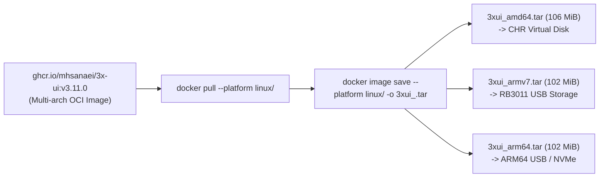

# MIKROZIA — PHASE 3 DEPLOYMENT PLAN: UNMODIFIED 3X-UI ON MIKROTIK ROUTEROS

**Document Version:** 2.0.0 (Audited, Scoped & Safety-Hardened)
**Date:** November 1, 2026
**Status:** HISTORICAL & NON-EXECUTABLE — DO NOT USE FOR INSTALLATION
**Current Policy:** Firewall/NAT examples are superseded; the current installer is container-only.
**Target Application:** Original 3x-ui `v3.11.0` (Upstream commit `c621ba9014a6aa21fd7c9ecf45655e44e24ebf13`)
**Strict Boundaries:** No application source code changes, no branding alterations, no automatic execution, no destructive router actions.

> [!NOTE]
> This document specifies lab verification procedures for specific reference fixtures. For the universal, environment-agnostic product architecture and configuration generator design, refer to [docs/MIKROZIA_GLOBAL_DEPLOYMENT_ARCHITECTURE.md](file:///Users/majidlotfi/Documents/Project/Mikrozia/docs/MIKROZIA_GLOBAL_DEPLOYMENT_ARCHITECTURE.md).

---

## 1. Objectives & Hardware Scope

This document specifies the exact deployment procedures for running the genuine, completely unmodified 3x-ui v3.11.0 container application on MikroTik RouterOS v7.25+ devices.

### 1.1 Supported Target Categories

1. **MikroTik Cloud Hosted Router (CHR) — x86_64** (Virtualized / Cloud VPS environments).
2. **MikroTik Physical ARM 32-bit (v7)** — Reference Hardware: **RB3011UiAS-RM** (RouterOS 7.25, IPQ8064 dual-core, 1024 MiB RAM, 128 MiB internal NAND, USB 3.0 storage).
3. **MikroTik Physical ARM64** — Reference Hardware: **RB5009UG+S+IN** / CCR2004 / CCR2116 / hAP ax³ (1024+ MiB RAM, external USB 3.0 or M.2 NVMe storage).

_System RAM Requirement:_ Minimum router system RAM is **1024 MiB**. The 128 MiB container memory benchmark remains a performance measurement baseline, not an artificial restriction to disable features.

---

## 2. Packaging & Image Preparation Pipeline

To prevent router crashes caused by extracting multi-architecture manifests or writing large layers to low-memory internal buffers, all deployment images are pre-packaged on an administrative workstation as single-architecture `.tar` files.



### 2.1 Verified Single-Architecture Packages

The packages have been generated and validated locally:

| Target Platform    | Architecture Tag | Output Archive   | File Size     | SHA-256 Checksum                                                   |
| :----------------- | :--------------- | :--------------- | :------------ | :----------------------------------------------------------------- |
| **CHR (x86_64)**   | `linux/amd64`    | `3xui_amd64.tar` | 111,005,696 B | `f8031caf2dc494f0821ccd3fffb04888379687cc219bed172b1053ba35026e76` |
| **RB3011 (ARM32)** | `linux/arm/v7`   | `3xui_armv7.tar` | 107,046,400 B | `50dfc7eff6cadbcf4d435689976d142bfc570caa0847f04895741ef71f17950f` |
| **ARM64 Devices**  | `linux/arm64`    | `3xui_arm64.tar` | 107,130,368 B | `8dba2aaac411d253b4b658134905293fa59b66b3e8b3ff7a5f14fc92ebb08c6a` |

_Note:_ Successful archive creation verifies binary completeness and packaging integrity, but does **not** replace physical acceptance testing on RouterOS.

---

## 3. Storage Provisioning Architecture

### 3.1 Cloud Hosted Router (CHR x86_64) Storage

- Uses the existing allocated virtual disk (typically 10 GiB to 20 GiB). A secondary virtual disk is **not required**.
- Designated directory layout:
  - Container rootfs: `containers/3xui/root`
  - Persistent database & encryption key: `containers/3xui/data` &rarr; mapped to `/etc/x-ui`
  - Certificates: `containers/3xui/cert` &rarr; mapped to `/root/cert`
  - Temporary extraction: `containers/tmp`

### 3.2 Physical Hardware (RB3011 ARM32 & ARM64) Storage

- **Strict NAND Exclusion:** Internal NAND flash (~89.9 MiB free on RB3011) **must never be used** for container extraction (`tmpdir`), rootfs layers (`root-dir`), or active SQLite database operations. Doing so will immediately exhaust router storage and cause flash memory wear.
- **External Storage Requirement:** An external USB 3.0 SSD or flash drive formatted as `ext4` is strictly required.
- **Formatting Safety Rule:** **Never execute automatic disk formatting commands** (such as `/disk format-drive`) in deployment scripts. Storage must be pre-formatted and mounted manually by the operator to protect existing storage data.
- Designated layout on external storage (`usb1/`):
  - Container rootfs: `usb1/3xui/root`
  - Persistent database & encryption key: `usb1/3xui/data` &rarr; mapped to `/etc/x-ui`
  - Certificates: `usb1/3xui/cert` &rarr; mapped to `/root/cert`
  - Temporary extraction: `usb1/tmp`

---

## 4. Network Isolation & Security Rules

To guarantee that the host router's existing configuration, interfaces, and firewall policies are completely preserved:

```
                           +-----------------------------------------------+
                           |          RouterOS Gateway / Firewall          |
                           +-----------------------------------------------+
                                    |                             |
                       [WAN Interface List]              [LAN Interface List / VPN]
                                    |                             |
                         DST-NAT (Port 10443)           DST-NAT / Direct (Port 2053)
                        [Inbound Proxy Traffic]           [Admin Panel - RESTRICTED]
                                    |                             |
                                    v                             v
                           +-----------------------------------------------+
                           |        dockers-br Bridge (172.16.10.1/24)      |
                           +-----------------------------------------------+
                                                   |
                                            veth-3xui (172.16.10.2/24)
                                                   |
                                                   v
                           +-----------------------------------------------+
                           |         3x-ui Unprivileged Container          |
                           |                                               |
                           |  - PID 1: /app/x-ui (Admin Panel :2053)       |
                           |  - Sub-server (:2096)                         |
                           |  - Xray Child (:10443 VLESS REALITY, etc.)    |
                           +-----------------------------------------------+
```

### 4.1 Strict Network Boundaries

1. **Isolated Bridge:** Container networking uses an isolated dedicated bridge (`dockers-br`) on `172.16.10.1/24`. It does not attach to or modify the router's primary LAN bridge (`bridge`), existing DHCP servers, or VLAN interfaces.
2. **Admin Panel Protection:** Port `2053` must **NEVER** have a DST-NAT rule listening on public WAN (`in-interface-list=WAN`). Management access is restricted to `in-interface-list=LAN` or management VPNs (e.g. WireGuard).
3. **Proxy Inbound Forwarding:** Only configured proxy ports (e.g., 10443 for REALITY) are forwarded from WAN.
4. **All Rules Scoped:** All firewall, bridge, and NAT rules are tagged with descriptive comments (`Mikrozia 3x-ui ...`) for safe, isolated identification.

---

## 5. RouterOS Deployment Scripts (.rsc)

### 5.1 Target A: Cloud Hosted Router (CHR x86_64)

```routeros
# ==============================================================================
# MIKROZIA PHASE 3 DEPLOYMENT: TARGET A (CHR x86_64)
# Virtual disk path: containers/
# ==============================================================================

# 1. Enable Container Device Mode (Confirmed directly on CHR console or reboot)
/system/device-mode/update container=yes

# 2. Setup Isolated Container Bridge and VETH
/interface/bridge/add name=dockers-br comment="Mikrozia 3x-ui Isolated Bridge"
/ip/address/add address=172.16.10.1/24 interface=dockers-br comment="Mikrozia Bridge Gateway"
/interface/veth/add name=veth-3xui address=172.16.10.2/24 gateway=172.16.10.1
/interface/bridge/port/add bridge=dockers-br interface=veth-3xui

# 3. NAT Configuration (Masquerade for Container Outbound Traffic)
/ip/firewall/nat/add chain=srcnat src-address=172.16.10.0/24 action=masquerade comment="Mikrozia 3x-ui Outbound NAT"

# 4. Port Forwarding: Proxy to WAN, Management RESTRICTED to VPN / LAN
/ip/firewall/nat/add chain=dstnat in-interface-list=WAN dst-port=10443 protocol=tcp action=dst-nat to-addresses=172.16.10.2 to-ports=10443 comment="Mikrozia 3x-ui Proxy Inbound (WAN)"
/ip/firewall/nat/add chain=dstnat in-interface=wireguard1 dst-port=2053 protocol=tcp action=dst-nat to-addresses=172.16.10.2 to-ports=2053 comment="Mikrozia 3x-ui Admin Panel (VPN Only)"

# 5. Global Container Settings (Using virtual disk path)
/container/config/set tmpdir=containers/tmp memory-high=256M memory-max=512M

# 6. Persistent Volume Mounts (RouterOS v7.21+ mount-list syntax)
/container/mounts/add list=3xui_data src=containers/3xui/data dst=/etc/x-ui
/container/mounts/add list=3xui_cert src=containers/3xui/cert dst=/root/cert

# 7. Environment Variables
/container/envs/add list=3xui_env key=XRAY_VMESS_AEAD_FORCED value="false"
/container/envs/add list=3xui_env key=XUI_PORT value="2053"

# 8. Import Container from Uploaded Archive
# Pre-requisite: Transfer 3xui_amd64.tar to containers/ using SFTP
/container/add file=containers/3xui_amd64.tar interface=veth-3xui root-dir=containers/3xui/root mountlists=3xui_data,3xui_cert envlist=3xui_env logging=yes start-on-boot=yes

# 9. Start Container (after extraction completes)
/container/start [find where root-dir~"containers/3xui/root"]
```

---

### 5.2 Target B: Physical RB3011UiAS (ARM 32-bit v7)

```routeros
# ==============================================================================
# MIKROZIA PHASE 3 DEPLOYMENT: TARGET B (RB3011UiAS ARM 32-bit)
# Storage: External USB 3.0 drive mounted at usb1/
# Pre-requisite: USB drive must be pre-formatted (ext4) and mounted as usb1
# ==============================================================================

# 1. Enable Container Device Mode (Requires physical button press confirmation within 5 min)
/system/device-mode/update container=yes

# 2. Setup Isolated Container Bridge and VETH
/interface/bridge/add name=dockers-br comment="Mikrozia 3x-ui Isolated Bridge"
/ip/address/add address=172.16.10.1/24 interface=dockers-br comment="Mikrozia Bridge Gateway"
/interface/veth/add name=veth-3xui address=172.16.10.2/24 gateway=172.16.10.1
/interface/bridge/port/add bridge=dockers-br interface=veth-3xui

# 3. NAT Configuration (Masquerade for Container Outbound Traffic)
/ip/firewall/nat/add chain=srcnat src-address=172.16.10.0/24 action=masquerade comment="Mikrozia 3x-ui Outbound NAT"

# 4. Port Forwarding: Proxy to WAN, Management RESTRICTED to LAN
/ip/firewall/nat/add chain=dstnat in-interface-list=WAN dst-port=10443 protocol=tcp action=dst-nat to-addresses=172.16.10.2 to-ports=10443 comment="Mikrozia 3x-ui Proxy Inbound (WAN)"
/ip/firewall/nat/add chain=dstnat in-interface-list=LAN dst-port=2053 protocol=tcp action=dst-nat to-addresses=172.16.10.2 to-ports=2053 comment="Mikrozia 3x-ui Admin Panel (LAN Only)"

# 5. Global Container Settings (Directing tmpdir to USB to spare internal NAND)
/container/config/set tmpdir=usb1/tmp memory-high=256M memory-max=512M

# 6. Persistent Volume Mounts (RouterOS v7.21+ mount-list syntax)
/container/mounts/add list=3xui_data src=usb1/3xui/data dst=/etc/x-ui
/container/mounts/add list=3xui_cert src=usb1/3xui/cert dst=/root/cert

# 7. Environment Variables
/container/envs/add list=3xui_env key=XRAY_VMESS_AEAD_FORCED value="false"
/container/envs/add list=3xui_env key=XUI_PORT value="2053"

# 8. Import Container from Uploaded Archive
# Pre-requisite: Transfer 3xui_armv7.tar to usb1/ using SFTP/SMB/WinBox
/container/add file=usb1/3xui_armv7.tar interface=veth-3xui root-dir=usb1/3xui/root mountlists=3xui_data,3xui_cert envlist=3xui_env logging=yes start-on-boot=yes

# 9. Start Container (after extraction completes)
/container/start [find where root-dir~"usb1/3xui/root"]
```

---

### 5.3 Target C: Physical ARM64 Hardware (e.g. RB5009)

```routeros
# ==============================================================================
# MIKROZIA PHASE 3 DEPLOYMENT: TARGET C (Physical ARM64 / RB5009)
# Storage: External USB 3.0 / M.2 drive mounted at usb1/ (or nvme1/)
# Pre-requisite: External drive must be pre-formatted (ext4) and mounted
# ==============================================================================

# 1. Enable Container Device Mode (Requires physical button press confirmation within 5 min)
/system/device-mode/update container=yes

# 2. Setup Isolated Container Bridge and VETH
/interface/bridge/add name=dockers-br comment="Mikrozia 3x-ui Isolated Bridge"
/ip/address/add address=172.16.10.1/24 interface=dockers-br comment="Mikrozia Bridge Gateway"
/interface/veth/add name=veth-3xui address=172.16.10.2/24 gateway=172.16.10.1
/interface/bridge/port/add bridge=dockers-br interface=veth-3xui

# 3. NAT Configuration (Masquerade for Container Outbound Traffic)
/ip/firewall/nat/add chain=srcnat src-address=172.16.10.0/24 action=masquerade comment="Mikrozia 3x-ui Outbound NAT"

# 4. Port Forwarding: Proxy to WAN, Management RESTRICTED to LAN / VPN
/ip/firewall/nat/add chain=dstnat in-interface-list=WAN dst-port=10443 protocol=tcp action=dst-nat to-addresses=172.16.10.2 to-ports=10443 comment="Mikrozia 3x-ui Proxy Inbound (WAN)"
/ip/firewall/nat/add chain=dstnat in-interface-list=LAN dst-port=2053 protocol=tcp action=dst-nat to-addresses=172.16.10.2 to-ports=2053 comment="Mikrozia 3x-ui Admin Panel (LAN Only)"

# 5. Global Container Settings (Using external storage path)
/container/config/set tmpdir=usb1/tmp memory-high=256M memory-max=512M

# 6. Persistent Volume Mounts (RouterOS v7.21+ mount-list syntax)
/container/mounts/add list=3xui_data src=usb1/3xui/data dst=/etc/x-ui
/container/mounts/add list=3xui_cert src=usb1/3xui/cert dst=/root/cert

# 7. Environment Variables
/container/envs/add list=3xui_env key=XRAY_VMESS_AEAD_FORCED value="false"
/container/envs/add list=3xui_env key=XUI_PORT value="2053"

# 8. Import Container from Uploaded Archive
# Pre-requisite: Transfer 3xui_arm64.tar to usb1/ using SFTP/SMB/WinBox
/container/add file=usb1/3xui_arm64.tar interface=veth-3xui root-dir=usb1/3xui/root mountlists=3xui_data,3xui_cert envlist=3xui_env logging=yes start-on-boot=yes

# 9. Start Container (after extraction completes)
/container/start [find where root-dir~"usb1/3xui/root"]
```

---

## 6. Installation Readiness Checklist

Before executing any deployment on a target router, verify all items in the corresponding checklist:

### 6.1 CHR x86_64 Readiness Checklist

1. [ ] **System RAM:** CHR virtual machine allocated >= 1024 MiB RAM.
2. [ ] **Virtual Disk Capacity:** At least 2.5 GiB free on the primary virtual disk.
3. [ ] **Package Verification:** `container` package installed (`/system/package/print`).
4. [ ] **Device-Mode:** Container mode enabled (`/system/device-mode/print`).
5. [ ] **Archive Upload:** `3xui_amd64.tar` transferred to `containers/3xui_amd64.tar`.
6. [ ] **Checksum Match:** SHA-256 matches `f8031caf2dc494f0821ccd3fffb04888379687cc219bed172b1053ba35026e76`.

### 6.2 Physical RB3011UiAS ARM32 Readiness Checklist

1. [ ] **RouterOS Version:** RouterOS v7.25 or newer installed.
2. [ ] **System RAM:** Verified 1024 MiB total system RAM.
3. [ ] **USB Storage Attached:** USB 3.0 drive connected and recognized under `/disk/print`.
4. [ ] **Storage Filesystem:** USB drive manually pre-formatted as `ext4` with at least 2 GiB free capacity.
5. [ ] **NAND Protection:** Verified that internal NAND is NOT selected for `tmpdir` or `root-dir`.
6. [ ] **Container Package:** `container` package installed (`/system/package/print`).
7. [ ] **Device-Mode Confirmation:** Physical button press or power cycle executed within the 5-minute security window.
8. [ ] **Archive Upload:** `3xui_armv7.tar` transferred to `usb1/3xui_armv7.tar`.
9. [ ] **Checksum Match:** SHA-256 matches `50dfc7eff6cadbcf4d435689976d142bfc570caa0847f04895741ef71f17950f`.

### 6.3 Physical ARM64 Readiness Checklist

1. [ ] **RouterOS Version:** RouterOS v7.20+ installed.
2. [ ] **System RAM:** Verified >= 1024 MiB system RAM.
3. [ ] **Storage:** External USB 3.0 or M.2 NVMe drive formatted as `ext4` with at least 2 GiB free capacity.
4. [ ] **Device-Mode Confirmation:** Container mode confirmed via physical authorization.
5. [ ] **Archive Upload:** `3xui_arm64.tar` transferred to storage (`usb1/` or `nvme1/`).
6. [ ] **Checksum Match:** SHA-256 matches `8dba2aaac411d253b4b658134905293fa59b66b3e8b3ff7a5f14fc92ebb08c6a`.

---

## 7. Scoped Rollback & Disaster Recovery Procedures

To guarantee that tearing down Mikrozia **never impacts unrelated containers, mounts, or host configurations**, rollback commands target strictly Mikrozia-tagged resources:

```routeros
# ==============================================================================
# MIKROZIA SCOPED ROLLBACK SCRIPT (SAFE & TARGETED)
# ==============================================================================

# 1. Stop and Remove ONLY the Mikrozia Container
/container/stop [find where root-dir~"3xui/root"]
:delay 5s
/container/remove [find where root-dir~"3xui/root"]

# 2. Remove ONLY Mikrozia Bind Mounts
/container/mounts/remove [find where list="3xui_data" or list="3xui_cert"]

# 3. Remove ONLY Mikrozia Environment Lists
/container/envs/remove [find where list="3xui_env"]

# 4. Remove ONLY Mikrozia Firewall Port Forwarding & NAT Rules
/ip/firewall/nat/remove [find where comment~"Mikrozia 3x-ui"]

# 5. Remove ONLY the Mikrozia Isolated Bridge & VETH Interface
/interface/bridge/port/remove [find where interface="veth-3xui"]
/interface/veth/remove [find where name="veth-3xui"]
/interface/bridge/remove [find where name="dockers-br"]
/ip/address/remove [find where interface="dockers-br"]

# 6. Storage Cleanup (Manual & Selective)
# Delete extracted rootfs layers:
/file/remove [find where name~"3xui/root"]
# Optional: Delete persistent database ONLY if full purge is desired:
# /file/remove [find where name~"3xui/data"]
```

_Result:_ The host router returns to its exact previous state. No other containers, interfaces, or firewall policies are affected.
